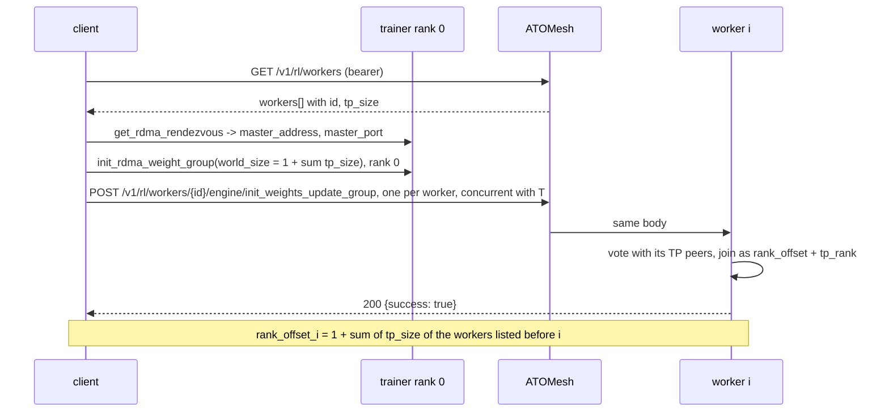
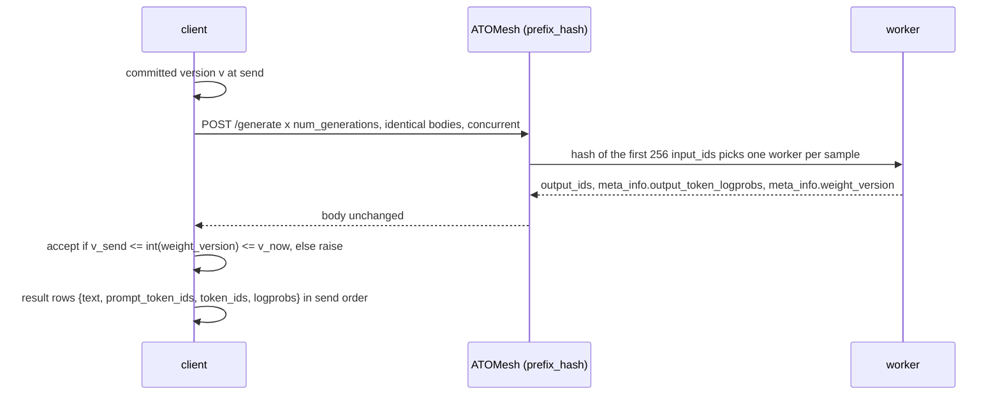
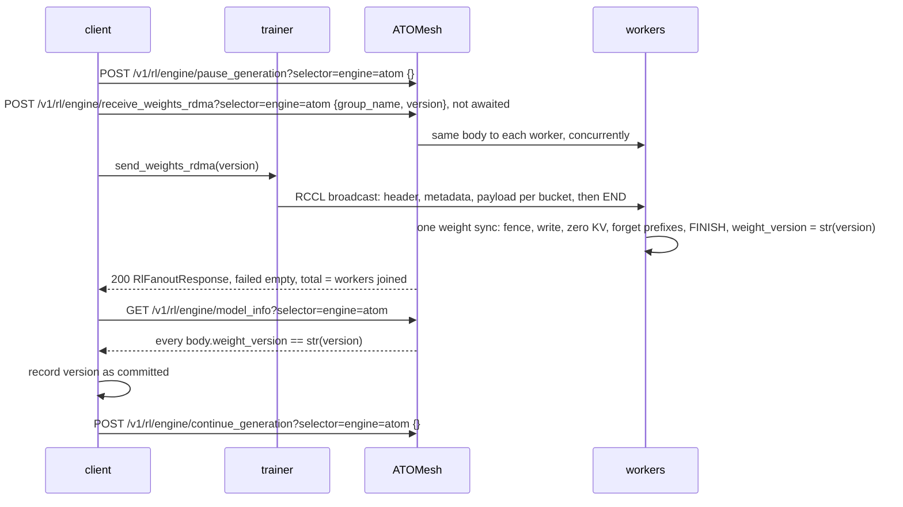

# AtomRL rollout through ATOMesh: the wire contract

AtomRL's trainer generates rollouts and pushes weights to ATOM workers
through ATOMesh instead of driving ATOM in-process over Ray. This document
fixes what crosses the wire for M1 of the requirement
(wuhuikx/LLM-Booster#718: Qwen3-8B BF16 DAPO, 4 training and 4 rollout GPUs on
one node, 4 TP1 ATOM workers behind ATOMesh with `prefix_hash` routing,
weights over RCCL). The ATOMesh control plane it rides on is
[`atomesh_rl_control_plane.md`](atomesh_rl_control_plane.md) ("D<n>" and "M<n>"
below are its decisions); principles are in
[`agent_team_principles.md`](agent_team_principles.md).

Code is cited as `path: symbol`: ATOM and ATOMesh at `atomesh-rl` 8064deeb,
ATOMesh paths relative to `atom/mesh/`; AtomRL at ROCm/ATOM#3355 5ae8ecaa,
relative to `atomrl/atomrl/`, which wuhuikx/ATOM#1 imports unchanged.
"The direct path" is AtomRL driving ATOM in-process
(`engine/inference/atom_ray_server.py: ATOMRayServer`, `ATOMReplicaManager`),
the A/B baseline.

## Participants

| Name | What it is |
|---|---|
| client | AtomRL's ATOMesh rollout client (`engine/inference/atomesh_rollout.py`, #5 and #6), in the trainer process |
| trainer | AtomRL's actor workers; rank 0 hosts the RCCL rendezvous and broadcasts (`send_weights_rdma`) |
| ATOMesh | launched with `--enable-rl --rl-api-key <key> --policy prefix_hash`, D12's long-rollout profile, and `--rl-control-timeout-secs` set to `weight_sync.timeout_s` |
| worker | an ATOM `api_server` with `--enable-rl --weight-version 0`, TP1 |

## Scenarios

### S1. Setup: join the weight group once



Request, per worker (worker 2 of 4 at TP1):

```json
POST /v1/rl/workers/{id}/engine/init_weights_update_group
{"master_address": "10.0.0.5", "master_port": 29731, "rank_offset": 3,
 "world_size": 5, "group_name": "atomesh-rl-weights-4121", "backend": "nccl"}
```

The answer is ATOMesh's `RlCallOutcome` around the worker's
`{"success": true, "message": "init_weights_update_group succeeded"}`.
At shutdown the client sends `POST
/v1/rl/engine/destroy_weights_update_group?selector=engine=atom`
`{"group_name": ...}` and the trainer leaves its side.

### S2. A prompt group, on-policy (`/generate`)



Request, one sample:

```json
POST /generate
{"input_ids": [151644, 872, 198, 785],
 "sampling_params": {"max_new_tokens": 4096, "temperature": 1.0,
                     "top_p": 1.0, "top_k": -1},
 "return_logprob": true}
```

Response:

```json
{"text": " 42",
 "output_ids": [220, 19, 17, 151643],
 "meta_info": {
   "id": "generate-3f0c9b",
   "finish_reason": {"type": "stop"},
   "prompt_tokens": 4,
   "completion_tokens": 4,
   "cached_tokens": 0,
   "weight_version": "7",
   "output_token_logprobs": [[-0.12, 220, null], [-1.03, 19, null],
                             [-0.40, 17, null], [-0.01, 151643, null]]}}
```

The client's row for this sample is `{"text": " 42", "prompt_token_ids":
<the input_ids it sent>, "token_ids": output_ids, "logprobs": [field 0 of
each output_token_logprobs entry]}`, the shape
`ATOMRayServer.generate_batch` and `generate_group` return; `logprobs` is
null when the trainer did not ask for them.

### S3. A weight sync



`version` is the trainer's rollout version after the step,
`global_step + 1`, as on the direct path. Request through ATOMesh, and what
each worker answers:

```json
POST /v1/rl/engine/receive_weights_rdma?selector=engine%3Datom
{"group_name": "atomesh-rl-weights-4121", "version": 7}

worker: 200 {"success": true, "message": "receive_weights_rdma succeeded"}
        400 {"success": false, "message": "<why>"}
```

ATOMesh answers `{"results": {<worker id>: RlCallOutcome}, "failed":
[RlFailedCall], "total": 4, "succeeded": 4}`, 200 when nothing failed and
207 otherwise (D2; `src/rl/fanout.rs`). `model_info`'s worker body is
`{"model_path": "...", "weight_version": "7"}`.

Any failure in steps 2 to 4 (a 207, an error, `total` short of the workers
joined at setup, a version not reported, the sender raising) still sends
`continue_generation` and then raises; the run stops (C10).

### S4. Fully async with partial rollout, across a sync

```text
client committed v=6
  t0  sample A sent           v_send = 6
  t1  sync to 7 starts: pause; A is held in the worker (keep mode)
  t2  receive + broadcast; the worker preempts A, commits "7"
  t3  model_info all "7" -> client commits 7 -> continue
  t4  A recomputes its context on the new weights, finishes: weight_version "7"
      6 <= 7 <= 7 -> accepted (RolloutGroup.version 6, finished_version 7)
  sample B finished at t1 just before the pause, response read at t3.5:
      weight_version "6", 6 <= 6 <= 7 -> accepted
  sample C from a worker that re-registered fresh: weight_version "0"
      0 < 6 -> rejected: WeightVersionMismatch, the step fails
```

## Decisions

### C1. `/generate` is SGLang's, logprobs included

The request is SGLang's `/generate` body as ATOM serves it (D9) plus
SGLang's top-level `return_logprob`; per-token logprobs come back as
SGLang's `meta_info.output_token_logprobs`, one `[logprob, token_id, null]`
per output token. Only `input_ids` input is used; the client never sends
`text`.

- Basis: principle: SMG's protocol is the spec. code: `openai-protocol`
  1.0.0 (ATOMesh's protocol crate) `generate.rs: GenerateRequest.return_logprob`
  and `GenerateMetaInfo.output_token_logprobs`
  (`Vec<Vec<Option<f64>>>`, so the third field is null);
  `api_server.py: _GenerateRequest`. AtomRL's rollout sends token ids
  (`trainer/rl_trainer.py: RLTrainer._ray_rollout_prompt_ids`).
- Rejected: a top-level `logprobs: [float]`, ATOMRayServer's own result
  field. An SGLang client would not find it, and it is one more shape to
  keep.

### C2. Sampling fields: all of AtomRL's, mapped, unknown keys refused

| AtomRL key (`_ray_sampling_params`, `_ray_eval_sampling_params`) | On the wire |
|---|---|
| `max_tokens` | `sampling_params.max_new_tokens`, clamped to `max_model_len - len(input_ids)` as `ATOMRayServer._build_sampling_params` does |
| `temperature`, `top_p`, `top_k` | `sampling_params.` same names |
| `logprobs` (AtomRL sends `0` to ask) | `return_logprob: true` |

The client raises on any other key. `seed` is not among them: the direct
path derives one server-side and drops it, since ATOM's `SamplingParams`
has none; neither path seeds ATOM.

- Basis: code: `rl_trainer.py: RLTrainer._ray_sampling_params`,
  `_ray_eval_sampling_params` (the only dicts the rollout sends);
  `atom_ray_server.py: ATOMRayServer._build_sampling_params`;
  `atom/sampling_params.py: SamplingParams` (no `seed`);
  `api_server.py: _GenerateSamplingParams` is a pydantic model that ignores
  unknown keys.
- Rejected: forward the dict verbatim. ATOM would drop an unknown key
  without a word, the silent drop the brief forbids.

### C3. A logprob is the sampled token's, as the direct path reads it

Field 0 of the engine's `TokenLogprob` record: the value
`LLMEngine.generate` hands the direct path for the same token. When
`return_logprob` is set, `len(output_token_logprobs) == len(output_ids)`,
and `text` is still the decoded output (`generate_async` leaves it empty
when logprobs are on; #4 fills it). The parity reference for #4's test is
`/v1/chat/completions` with `prompt_token_ids` and `logprobs: true`
(`choices[0].logprobs.content[].logprob`), or the mocked engine's records:
`/v1/completions` returns no logprobs.

- Basis: code: `atom/model_engine/token_logprobs.py: TokenLogprob`;
  `scheduler.py: Scheduler.postprocess` (`seq.logprobs` takes field 0);
  `api_server.py: generate_async` (text empty under logprobs);
  `protocol.py: BetaCompletionRequest` ("Completions return no token
  probabilities yet").
- Rejected: compare against `/v1/completions`, as #4's brief says. It
  returns none, so that test cannot be written.

### C4. `weight_version`: an integer in, a string out

`/receive_weights_rdma` takes `version` as a JSON integer, the stream
header's int64. A committed stream sets the engine's version to
`str(version)`, which `/generate` (`meta_info.weight_version`) and
`/model_info` report. Workers start with `--weight-version 0`, the rollout
version of a fresh run.

- Basis: code: `atom/rollout/rdma_weight_receiver.py` (module doc: header
  `[command, metadata_bytes, payload_bytes, version]`),
  `RDMAWeightReceiverMixin.receive_weights_rdma(version: int)`;
  `arg_utils.py: EngineArgs.weight_version` (a string, default
  `"default"`); `openai-protocol: GenerateMetaInfo.weight_version: String`;
  `rl_trainer.py: RLTrainer._train_with_ray_controller` (`rollout_version =
  start_step`, then `step + 1`).
- Rejected: report an integer. D8 and SGLang both type it a string.

### C5. A group is `num_generations` requests

Each sample of a prompt is its own `/generate` with the same body, sent
concurrently; the rows come back in send order. The brief and #718 (M1,
`prefix_hash`) fix this. ATOMesh hashes the first 256 `input_ids`, so a
group lands on one worker unless that worker's load passes 1.25 times the
mean, when later samples walk the ring to the next.

- Basis: code: `src/policies/prefix_hash.rs: PrefixHashConfig`
  (`prefix_token_count` 256, `load_factor` 1.25);
  `src/routers/prepare/inference.rs` routes a single `input_ids` array by
  tokens; `api_server.py: _GenerateRequest` has no `n`.
- Rejected: one request with `sampling_params.n`. ATOM's `/generate` has no
  `n`.

### C6. Which samples are rejected

The client keeps the version it last committed (C4's 0 at start, then each
sync's, recorded before it resumes the workers). A sample is accepted when
`v_send <= int(meta_info.weight_version) <= v_now`: the version committed
when its request was sent, and when its response was read. In on-policy
rollout nothing is in flight across a sync, so this is equality.

- Basis: code: D8 (a request in flight across a refit reports the version
  its last token was sampled under); `trainer/fully_async_rollout.py:
  RolloutGroup` (`version`, `finished_version`) expects a partial-rollout
  group to finish on newer weights. A response finished just before a
  pause can be read after the next commit (S4, sample B).
- Rejected: equality with the current version. It rejects every partial
  rollout that crossed a sync, and sample B.

### C7. A rejection fails the step

The client raises `WeightVersionMismatch` with the sample's version, the
accepted range and the request id. Nothing is resubmitted.

- Basis: a mismatch means a worker serves weights the client never
  committed (a missed sync, or a restarted worker), which #718's version
  item already fails. principle: the simplest solution that meets
  acceptance (agent-team defaults).
- Rejected: drop the group and resubmit. Training continues on a pool that
  still holds the bad worker, and the A/B never sees it.

### C8. The weight group is joined once, at setup

S1: the trainer's join and one `init_weights_update_group` per worker,
concurrently, before the first rollout; `rank_offset` from the order of
`/v1/rl/workers`, `tp_size` from its entries (D13). Each sync only
streams. The group name is unique per run.

- Basis: code: `atom_ray_server.py: ATOMReplicaManager.init_rdma_weight_group`
  forms one persistent group at setup (`rl_trainer.py:
  RLTrainer._setup_ray_atom_rollout`), so the direct path's sync time holds
  no rendezvous; `rdma_weight_receiver.py: init_rdma_weight_group` reuses a
  same join, so a trainer that formed a new group each sync would broadcast
  on a group the workers never joined; `api_server.py: _RL_GROUP_ROUTES`
  maps `rank_offset` to `base_rank`.
- Rejected: join and destroy around every sync, as SMG's trainer does (A3).
  It adds a rendezvous to the sync time the A/B compares.

### C9. One sync is one call sequence, and it alone pauses

S3's sequence, in both rollout modes. Under `transport: atomesh` no other
code pauses or resumes the workers: the streaming rollout's backend
`pause()` and `resume()` send nothing, and `continue_generation` is sent on
every exit of the sync. The receive fan-out is sent before the trainer
broadcasts and awaited after, as the direct path arms its receivers
un-awaited.

- Basis: code: `atom_ray_server.py:
  ATOMReplicaManager.start_receive_weights_rdma` ("all receivers and the
  trainer's sender must sit inside the broadcast at once");
  `fully_async_rollout.py: StreamingRollout.before_sync`, `after_sync`
  pause only with `partial_rollout`; `engine_utility.py:
  _handle_pause_generation` (`keep`: running requests wait, the update
  preempts them). The brief names pause through resume.
- Rejected: pause only under partial rollout, as the direct path does. Two
  sequences to test, to save one control call when nothing is in flight.

### C10. A sync is confirmed by its answers and by `model_info`; a failure stops the run

Confirmed when the receive fan-out answers 200 with `total` equal to the
workers joined at setup, and the `model_info` fan-out reports
`str(version)` on every worker. `/v1/rl/workers[].weight_version` is not
read: it is the registration label (D8). On any failure the client resumes
the workers and raises; it neither rebuilds the group nor retries.

- Basis: code: `src/rl/fanout.rs` (207 when any call failed; a non-2xx
  worker answer lands in `failed`); `rdma_weight_receiver.py`: a refused
  stream is still drained, a rank out of step leaves the group;
  `engine_utility.py: EngineUtilityHandler` keeps an engine whose weights
  are not whole fenced until a full sync (M5). The brief of #6: a failed
  receive leaves workers resumed and raises.
- Rejected: re-join and retry. Recovery code that no acceptance item
  exercises: #718 counts any failure.

### C11. `/receive_weights_rdma` carries `group_name` and `version` only

The route answers SGLang's `{success, message}` like the other RL routes.
The direct path's `verify_full_load` and `prequantized_fp8` have no field:
ATOM checks coverage itself and receives BF16 only, so under
`transport: atomesh` the trainer refuses FP8 weight sync and
`weight_sync.rdma.require_rdma: true` at setup (the direct path's preflight
and capability probes are Ray calls with no `/v1/rl` route; M1 is one
node). A worker that cannot join refuses in its join vote, so its
`init_weights_update_group` answers 400.

- Basis: code: `api_server.py: _rl_route`, `_rl_reply`;
  `atom/rollout/async_engine.py: AsyncLLMEngine.receive_weights_rdma`;
  `atom_ray_server.py: ATOMRayServer.receive_weights_rdma` (ignores
  `verify_full_load`, refuses `prequantized_fp8`),
  `ATOMReplicaManager.init_rdma_weight_group` (preflight);
  `rdma_weight_receiver.py: init_rdma_weight_group` (vote before the
  rendezvous).
- Rejected: engine routes for preflight and capabilities. Surface no M1
  item needs.

### C12. Timeouts, auth and failed requests

- The group's broadcast timeout is the engine's default 600 s:
  `init_weights_update_group` carries no timeout, and AtomRL's default
  `weight_sync.timeout_s` is 600. ATOMesh's per-call control timeout is
  `weight_sync.timeout_s`; the client waits 14400 s on `/generate`, D12's
  request timeout.
- Every `/v1/rl` call carries `Authorization: Bearer <rollout.api_key>`,
  ATOMesh's `--rl-api-key`; `/generate` carries none.
- A `/generate` answered with any status but 200, or with a
  `finish_reason.type` other than `stop` or `length` (such as
  `logprob_error` or `abort`), raises; nothing is retried.
- Basis: code: `rdma_weight_receiver.py: init_rdma_weight_group(timeout_s=600)`;
  `core/config.py: WeightSyncConfig.timeout_s`; `src/rl/config.rs`
  (`--rl-control-timeout-secs`); `src/server.rs: build_app` puts no auth
  layer on inference routes, and `cliargs.rs: api_key` is the key ATOMesh
  presents to workers; `api_server.py: _sglang_finish_reason`. #718
  acceptance counts failed requests.
- Rejected: a `timeout_s` field on `init_weights_update_group`. SGLang's
  body has none, and the value already matches. Rejected: retry a failed
  `/generate` once. It hides a failure the acceptance counts.

## Simpler alternative

Refit through the routes ATOM already serves: the client drives SMG's
trainer sequence (A3 on main: `init_weights_update_group`,
`update_weights_from_distributed` per chunk, `destroy_weights_update_group`)
and no `/receive_weights_rdma` route is added. It fails the requirement:
#718 assigns the `/receive_weights_rdma` route on `main`'s RCCL stream
format to the engine side, and the A/B compares sync time against a direct
path that streams buckets, not per-tensor broadcasts. A chunked trainer
refit also fails on every chunk once the weights are not whole (M5).

## Low confidence

None. Each decision rests on code at the cited commits or on the brief; the
GPU runs of #8 check them.

## Dependencies

No spike. No interface is upstream-only: `receive_weights_rdma` and its
stream are on `atomesh-rl` (`atom/rollout/rdma_weight_receiver.py`), and
AtomRL comes from ROCm/ATOM#3355 through #1.

## Summary

**Deliverable**: this contract, for #3 to #7 to build against.

**Scope and non-goals**: M1's wire. Not here: M2 (CUDA IPC), P/D, DP above
1 (the engine refuses a weight stream under DP), FP8 weight sync, recovering
from a failed sync, streaming `/generate`, `n` above 1 in one request.

**Change per file**

| File | Change | Task | Decisions |
|---|---|---|---|
| `atom/entrypoints/openai/api_server.py` | `/receive_weights_rdma` in `_RL_ROUTES`; version set to `str(version)` on commit | #3 | C4, C11 |
| `atom/entrypoints/openai/api_server.py` | `return_logprob` on `/generate`: `output_token_logprobs`, `text` decoded | #4 | C1, C3 |
| `atomrl/atomrl/engine/inference/atomesh_rollout.py` | `generate_batch` / group: C2 mapping, C5 fan-out, C6 check, C7 raise, C12 failures | #5 | C1-C7, C12 |
| `atomrl/atomrl/engine/inference/atomesh_rollout.py` | setup join, `sync_weights(version)`, `paused()` | #6 | C8-C11 |
| AtomRL config, trainer, launcher | `--weight-version 0`, `--rl-api-key`, `--rl-control-timeout-secs`; refuse FP8 sync and `require_rdma` under `atomesh`; backend `pause()` / `resume()` send nothing | #7 | C4, C9, C11, C12 |

**Acceptance**: this document approved by the reviewer agent and by
@junyyang-amd. Each item of #718 maps to the decisions it rests on:

| #718 item | Rests on |
|---|---|
| Accuracy: `reward/accuracy`, `k3_kl` match direct | C2, C3, C5 |
| Version: every worker reports the new version after each sync | C4, C9, C10 |
| Stability: 0 failed requests, 0 workers dropped | C7, C10, C12 |
| Performance record: sync time, trainer wait, `prefix_hash` hits | C8, C9; `meta_info.cached_tokens` per sample |
